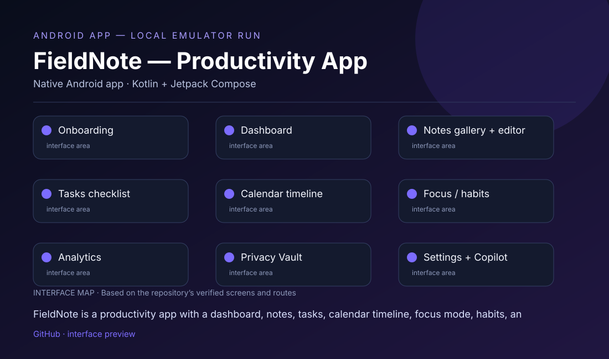

# FieldNote — Productivity App

## What this project is

FieldNote is a productivity app with a dashboard, notes, tasks, calendar timeline, focus mode, habits, analytics, privacy vault, settings, and an AI Copilot.

## Interface at a glance

This repository contains or plans the following visitor-facing areas:

- **Onboarding**
- **Dashboard**
- **Notes gallery + editor**
- **Tasks checklist**
- **Calendar timeline**
- **Focus / habits**
- **Analytics**
- **Privacy Vault**
- **Settings + Copilot**

The visual map above is based on the actual repository structure. It is deliberately labeled as an **interface map**, not a fabricated product screenshot.

## Run / view

Open the root in Android Studio, install Android SDK/compileSdk 36.1 and Java 11, sync Gradle, then run the app on an API 24+ emulator/device. Copy .env.example to a local .env only when Gemini is needed. The repository does not include a Gradle wrapper or a public APK yet.

**Repository link:** [https://github.com/mahatirmahmud688601-wq/FieldNote-](https://github.com/mahatirmahmud688601-wq/FieldNote-)

## Project status

> ANDROID APP — LOCAL EMULATOR RUN

No public APK or verified live demo is available yet. Screens in the preview are sourced from the actual Compose destinations found in the repository.

## Repository notes

- Keep API keys, OAuth secrets, signing keys, and private environment files out of Git.
- Add a verified public demo, APK, or release link here when one is available.
- Add real screenshots from the running app after the required local dependencies and credentials are configured.

## Technology

Native Android app · Kotlin + Jetpack Compose

---

Maintained by [mahatirmahmud688601-wq](https://github.com/mahatirmahmud688601-wq).
